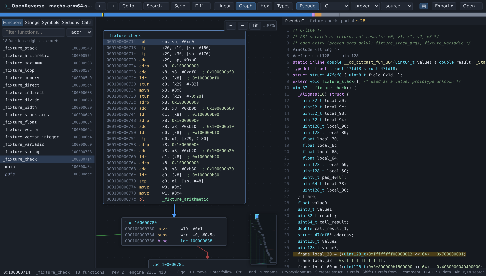

# OpenReverse

**Reverse engineering in your browser.** Disassembly, control-flow graphs and decompilation of native binaries, in the spirit of IDA and Binary Ninja, built on [OpenDecomp](https://github.com/DimitriFourny/open-decomp).

**[Open the app →](https://dimitrifourny.github.io/open-reverse/)**

Everything runs client-side: drop a binary on the page and it is analysed in your tab. Nothing is uploaded, there is no server, and your projects stay in the browser's storage.



Supported formats: **Mach-O ARM64, ELF x86-64 and PE x86-64**.

## Features

- **Disassembly** of the whole image (code and data) and a **control-flow graph** per function, with ARM64 `ADRP` pairs, GOT slots and Objective-C messages resolved into comments.
- **Pseudo-C / pseudo-Python** linked both ways with the disassembly.
- **Debug information**: DWARF embedded in Mach-O and ELF binaries, or from a debug file you add (a `.dSYM`, an ELF `--only-keep-debug` file, a PE's `.pdb`): names, prototypes, structures, globals, locals and source lines.
- **Annotate** with IDA-style keys: rename (`N`), types and signatures (`Y`), comments (`;`), data definitions (`D` `A` `O` `*` `U`), structures, bookmarks, all undoable (`Ctrl+Z`).
- **Navigate**: cross-references to and from (`X`, `Shift+X`), a call tree, a colour navigation band, go-to by name or address, and binary-wide search for bytes, text and immediates (`Alt+B` `Alt+T` `Alt+I`).
- **Script** the analysis from a JavaScript console (`Shift+F2`).
- **Diff** two versions of a binary function by function.
- **Keep your work**: projects persist in the browser, and you can export project archives and every function's pseudocode.

See the **[guide](docs/GUIDE.md)** for every feature, the keyboard reference and how it works.

## Build it yourself

You need Node.js 24+ and Bun 1.4.3.

```sh
git clone --recurse-submodules https://github.com/DimitriFourny/open-reverse.git
cd open-reverse
bun run setup    # builds OpenDecomp and installs dependencies
bun run dev      # http://localhost:5173
bun run build    # static site in web/dist/, host it anywhere
```

`scripts/deploy-pages.sh` publishes a build to the `gh-pages` branch.

## License

MIT, see [LICENSE](LICENSE). OpenDecomp is MIT-licensed too.
